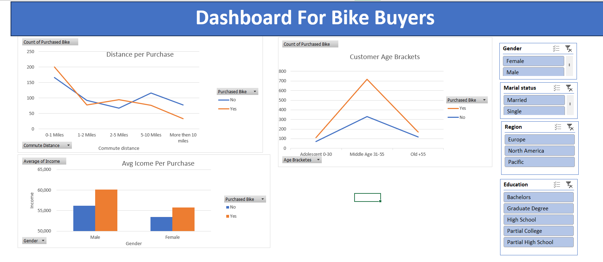
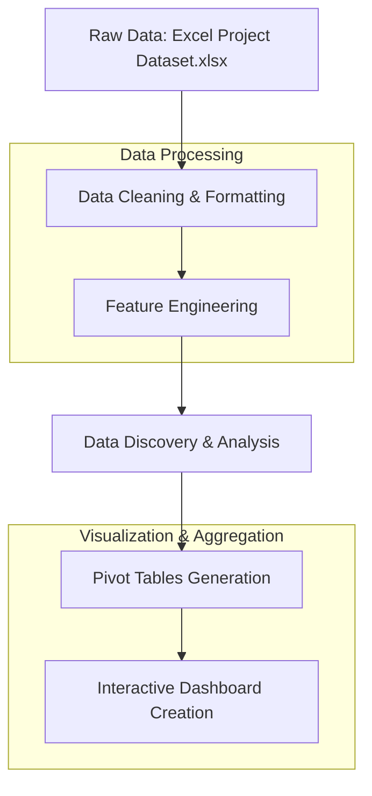

<h1 align="center">🚲 Bike Buyers Sales & Analytics Dashboard</h1>

<p align="center">
  
  
  
</p>

An end-to-end Excel data analytics project that cleans customer data, aggregates it using Pivot Tables, and visualizes purchasing trends to understand the key demographics of bike buyers.

## 📑 Table of Contents
- [Project Overview](#project-overview)
- [Dashboard Preview](#dashboard-preview)
- [Project Architecture](#project-architecture)
- [Data Dictionary](#data-dictionary)
- [File Structure](#file-structure)
- [Technical Implementation](#technical-implementation)
- [Pivot Tables Explanation](#pivot-tables-explanation)
- [How to Use](#how-to-use)

## 🎯 Project Overview
This project analyzes a dataset of potential customers to determine which factors most heavily influence whether someone will purchase a bike. By creating a dynamic dashboard, stakeholders can easily filter through demographic features like marital status, region, education, and gender to uncover deep purchasing insights.

## 📊 Dashboard Preview
The interactive dashboard uses interconnected slicers to filter three main visualizations simultaneously.



## 🏗️ Project Architecture
The data pipeline was built entirely in Microsoft Excel, moving from raw tabular data to an interactive visual interface.



## 📖 Data Dictionary
Based on the dashboard analysis, the dataset contains the following key customer attributes:

| Feature | Data Type | Description |
| :--- | :--- | :--- |
| **Purchased Bike** | Boolean (Target) | Whether the customer purchased a bike (Yes/No). |
| **Gender** | Categorical | Customer gender (Male/Female). |
| **Income** | Numeric | Annual income of the customer. |
| **Commute Distance** | Categorical | Distance the customer commutes (e.g., 0-1 Miles, 2-5 Miles). |
| **Age** | Numeric | Exact age of the customer. |
| **Age Brackets** | Categorical | *Engineered Feature:* Adolescent (0-30), Middle Age (31-55), Old (+55). |
| **Marital Status** | Categorical | Customer's marital status (Married/Single). |
| **Region** | Categorical | Geographic region (Europe, North America, Pacific). |
| **Education** | Categorical | Highest level of education completed. |

## 📂 File Structure

| File/Directory | Description |
| :--- | :--- |
| `Excel Project Dataset.xlsx` | **Main Project File:** Contains the raw customer data, working sheets, Pivot Tables, and the final Dashboard. |
| `image/Dashborad.png` | High-resolution screenshot of the final Excel Dashboard. |
| `README.md` | Project documentation and architectural overview (this file). |

## ⚙️ Technical Implementation

### Data Cleaning & Feature Engineering
To make the data suitable for Pivot Tables and visualization, several cleaning steps and formulas were applied:

```excel
/* 1. Removing Duplicates */
-- Handled via Data > Remove Duplicates to ensure unique customer records.

/* 2. Standardizing Categorical Values */
-- Replacing "M" with "Married" and "S" with "Single" using Find & Replace or nested IFs:
=IF(M2="M", "Married", IF(M2="S", "Single", M2))

/* 3. Creating Demographic Bins (Age Brackets) */
-- Grouping exact ages into meaningful demographic brackets:
=IF(L2>55, "Old", IF(L2>=31, "Middle Age", IF(L2<31, "Adolescent", "Invalid")))
```

## 📈 Pivot Tables Explanation
The dashboard is powered by three distinct Pivot Tables that aggregate the raw data into actionable summaries. Slicers are connected to all three Pivot Tables via *Report Connections*, allowing global filtering.

1. **Average Income Per Purchase (Bar Chart)**
   * **Rows:** Gender
   * **Columns:** Purchased Bike (Yes/No)
   * **Values:** Average of Income
   * *Insight:* Compares the purchasing power of male and female customers and how income levels correlate with the likelihood of buying a bike.

2. **Distance Per Purchase (Line Chart)**
   * **Rows:** Commute Distance
   * **Columns:** Purchased Bike (Yes/No)
   * **Values:** Count of Purchased Bike
   * *Insight:* Reveals how commute length affects purchase decisions. For example, shorter commutes (0-1 Miles) generally show a higher volume of bike purchases.

3. **Customer Age Brackets (Line Chart)**
   * **Rows:** Age Brackets (Adolescent, Middle Age, Old)
   * **Columns:** Purchased Bike (Yes/No)
   * **Values:** Count of Purchased Bike
   * *Insight:* Highlights the core demographic. Middle-aged customers (31-55) represent the largest segment of both total customers and actual bike buyers.

## 🚀 How to Use
1. Clone or download the repository to your local machine.
2. Open `Excel Project Dataset.xlsx` using Microsoft Excel.
3. Navigate to the **Dashboard** sheet.
4. Click on the options within the **Slicers** (Gender, Marital Status, Region, Education) on the right side of the screen.
5. Watch the Pivot Charts dynamically update to reflect the specific demographic segment you have selected!